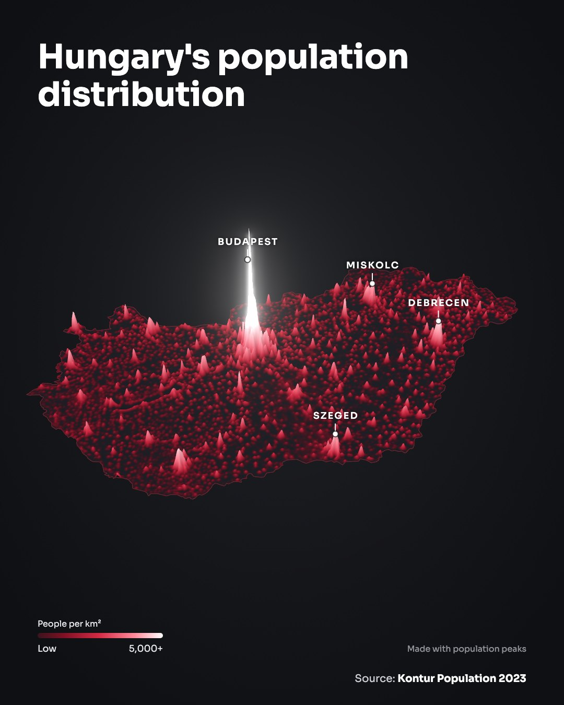
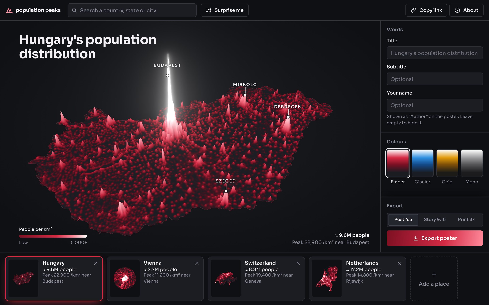
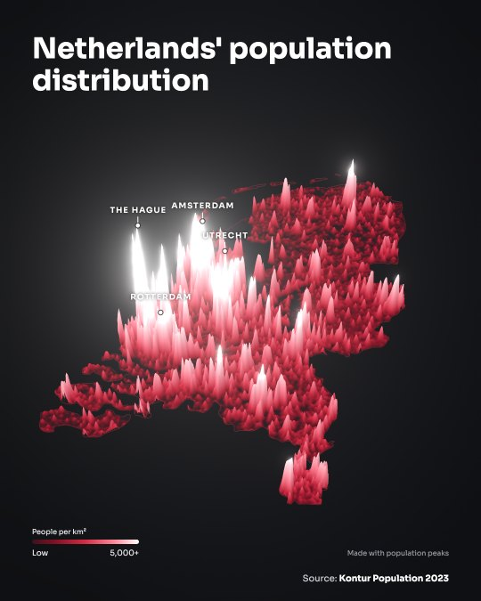
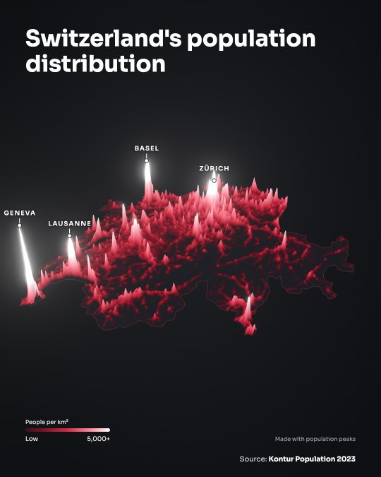
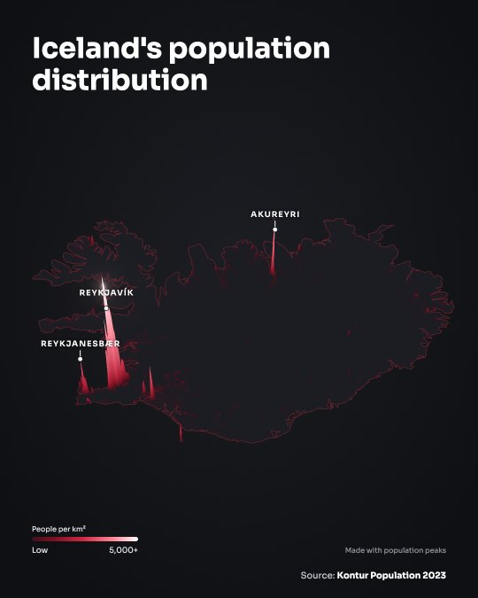
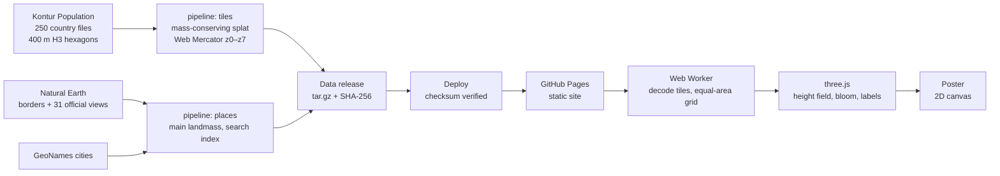

# population peaks

**Turn any country, state or city into a glowing 3D map of where its people live, then export it as a poster.**

[**Open the site →**](https://daksh-malhan.github.io/population-peaks/)

[](https://github.com/daksh-malhan/population-peaks/actions/workflows/ci.yml)
[](https://github.com/daksh-malhan/population-peaks/actions/workflows/codeql.yml)
[](https://scorecard.dev/viewer/?uri=github.com/daksh-malhan/population-peaks)
[](LICENSE)

<p align="center">
  
</p>

Every spike is people: the taller and brighter it is, the more people live per square kilometre.
The style follows the population maps by [Tulparmaps](https://www.instagram.com/tulparmaps/),
and the data is the same: Kontur Population 2023, 400 m hexagons covering the whole world.



## What you can do

- **Pick any place.** Search about 250 countries, 4,500 states and provinces, and every city with more than 100,000 people.
  Local spellings work too: *Wien*, *München*, *Praha*, *Bombay*. Or press **Surprise me**.
- **Collect a gallery.** Each place becomes a card with its population and densest spot. Compare places on their own scale, or put them all on the same height scale.
- **Shape the poster.** Rewrite the title, add your name, pick one of four colour sets, raise or lower the spikes, and hide, rename or add city labels. A city is a circle you can resize, from 10 to 100 km.
- **Export.** An Instagram post (1080×1350), a story (1080×1920), or a print size three times larger. On phones the poster goes straight to the share sheet.
- **Share.** A link carries the whole gallery. Links to a country show its poster as the preview in WhatsApp, iMessage and X.
- **Borders.** Some borders are disputed. The map uses the official view of your country when Natural Earth has one, and otherwise shows who controls each area. You can change this under **About**.

<p align="center">
  
  
  
</p>

## How it works



1. **Pipeline (Python).** Each hexagon's population is spread over Web Mercator pixels by exact footprint overlap, so no person is lost or counted twice (border hexagons appear in two country files and are deduplicated). The result is a tile pyramid of `uint16` values, `round(ln(1 + people/km²) × 256)`, zlib-compressed: about 150–250 MB for the whole world.
2. **Places.** Natural Earth outlines are simplified and framed on each country's main landmass. The US shows its contiguous states, France includes Corsica, and Alaska and Hawaii are their own states. Regions that cross the 180° meridian, like Russia and Fiji, are kept continuous.
3. **In the browser.** A Web Worker fetches only the tiles a place needs and measures its population exactly. It then resamples onto an equal-area grid centred on the place. three.js draws that grid as a height field with a bloom glow; city labels and the legend follow the reference poster.
4. **No canvas read-back for data.** Tiles are decoded with `DecompressionStream`, and outlines are rasterised in plain TypeScript. Safari and Brave add noise to pixels read back from a canvas, which would corrupt the numbers.

More detail: [docs/architecture.md](docs/architecture.md) · [docs/data-format.md](docs/data-format.md)

## Privacy and security

No accounts, cookies, analytics or third-party requests. The site is static files. Your gallery lives in the link you share and in your own browser's storage.

Every page carries a strict Content Security Policy, and the UI is built without HTML strings (lint-enforced). Shared links are validated against a schema. Data releases are checksummed and pinned, dependencies are pinned and audited, and every GitHub Action is pinned to a commit. CodeQL, Dependabot and OpenSSF Scorecard run on every change. See [SECURITY.md](SECURITY.md) to report a problem.

## Run it locally

You need Node 24 and Python 3.12+.

```bash
npm ci
python3 -m venv pipeline/.venv
pipeline/.venv/bin/pip install --require-hashes -r pipeline/requirements.txt -r pipeline/requirements-dev.txt
```

Build data for a few countries into `public/data/` (git-ignored):

```bash
cd pipeline
.venv/bin/python -m pp_pipeline.build tiles --countries HU,AT,CH --out ../public/data
.venv/bin/python -m pp_pipeline.build fetch-places --src ../work/src --povs ind
.venv/bin/python -m pp_pipeline.build places --src ../work/src --out ../public/data
cd ..
npm run dev
```

Then open <http://localhost:5173/population-peaks/>.

| Command | Runs |
|---|---|
| `npm test` | Unit tests (Vitest) |
| `npm run test:e2e` | End-to-end tests (Playwright) on a production build with a synthetic test world |
| `npm run test:pipeline` | Pipeline tests (pytest) |
| `npm run lint` / `npm run typecheck` | ESLint and TypeScript |

## Data releases

The **Build data release** workflow downloads all 250 Kontur files, verifying each against its S3 ETag. It builds the tiles, places and per-country previews, and publishes them as a GitHub release with a SHA-256 checksum. To put a release live, change `data-release.json` in a pull request; the deploy workflow verifies the checksum before publishing.

## Limits

- Population numbers are Kontur's 2023 estimates. Totals shown on cards are rounded and can differ slightly from official figures, especially for very small places.
- Detail is about 1 km, so city views are smooth rather than street-level.
- GitHub Pages can't send security headers, so the policy is set in the page. That means framing by other sites can't be blocked.
- 3D needs WebGL2. Without it, country pages show a pre-rendered poster.

## Credits

Population: [Kontur Population 2023](https://data.humdata.org/dataset/kontur-population-dataset) (CC BY 4.0).
Borders: [Natural Earth](https://www.naturalearthdata.com/) (public domain).
Cities: [GeoNames](https://www.geonames.org/) (CC BY 4.0).
Typeface: Sora (OFL). Rendering: three.js.
Style inspired by [Tulparmaps](https://www.instagram.com/tulparmaps/). Full list in [NOTICE.md](NOTICE.md).

Code under the [MIT licence](LICENSE).
